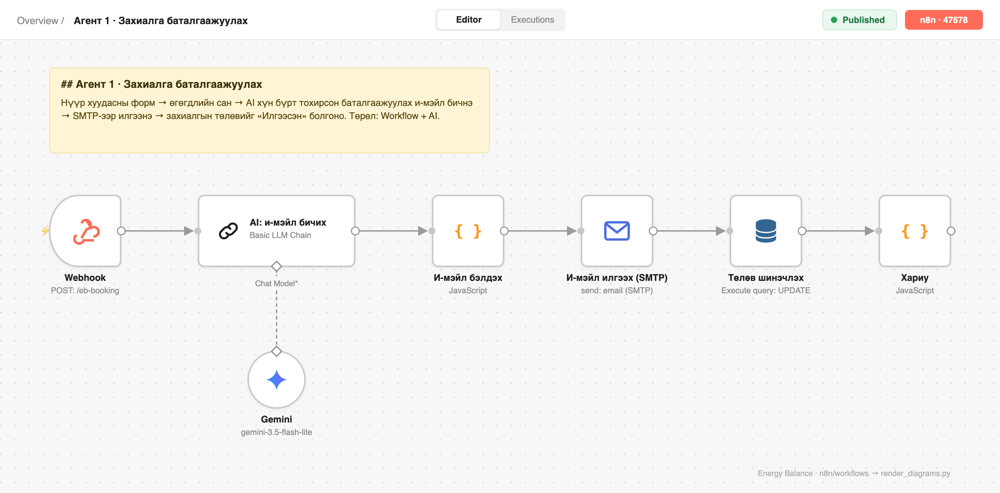
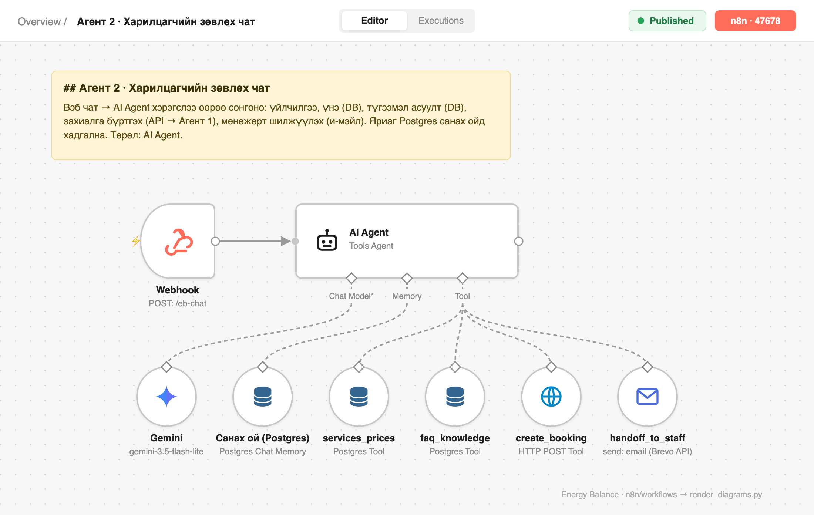
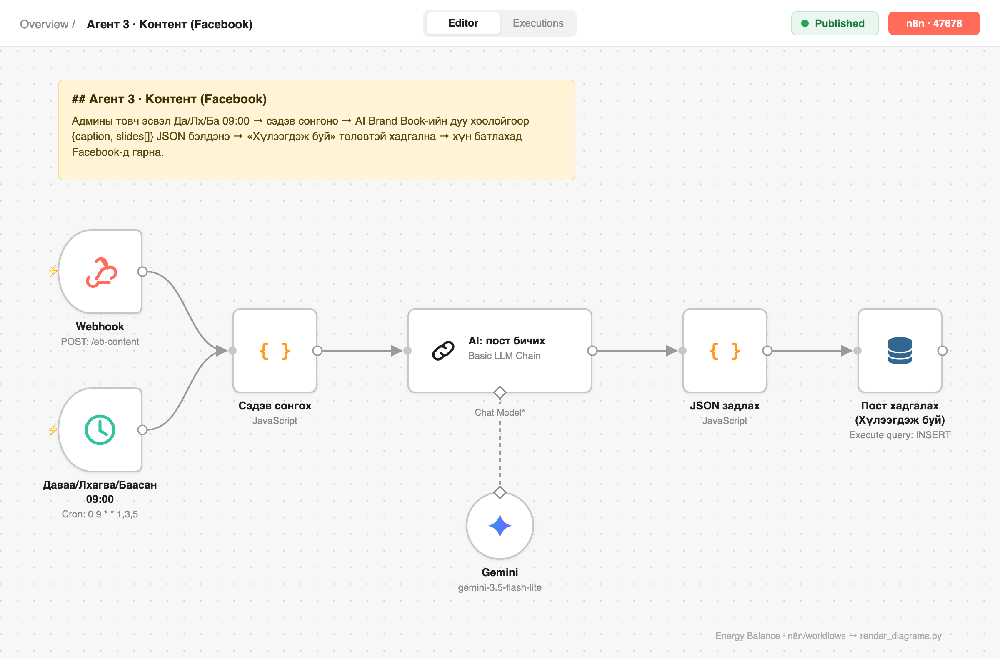
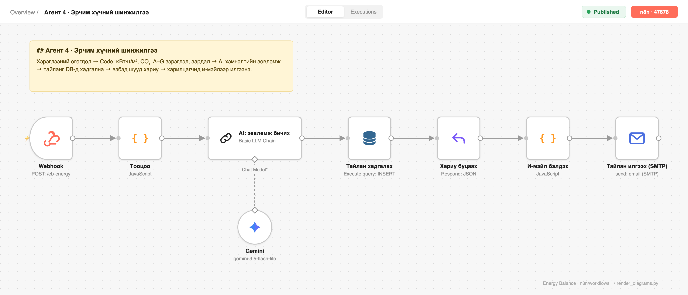

# Energy Balance — AI систем (EBRD AI for SME Consultants · Capstone)

«Энержи Баланс ХХК»-ийн (energybalance.mn) эрчим хүчний аудит, зөвлөх үйлчилгээг автоматжуулсан демо систем.
Хичээл дээр «Тэнгэр Трайвел»-д хийсэн архитектурыг бүхэлд нь **локал Docker** дээр давтсан. Шинэ бүртгэл (Supabase, n8n Cloud, Gmail, Meta) үүсгэх шаардлагагүй.

## Capstone-ийн шаардлага (Google Classroom · EBRD_Capstone.pptx)
- Хамгаалалт: **20/11, биечлэн**. Багшид шалгуулах: **18/11-ний өмнө** танилцуулгын линк, ажиллаж буй видео, системийн холбоос.
- Баг бүр **10 минут** танилцуулга + 5 минут асуулт: Асуудал 1 → Шийдэл 2 → **Live демо 4** → Үр дүн (тоогоор) 2 → Дараагийн алхам 1.
- Видео дээр API түлхүүр, нууц үг харагдах ёсгүй. Интернэт тасарвал нөөц видео бэлэн байлгах.
- Сертификат: 6/11, 13/11-ний workshop-д бүтэн суусан + байгууллагынхаа нэг хүнийг оролцуулсан + Capstone хамгаалсан.

| Capstone шаардлага | Энд |
|---|---|
| 1. Брэндтэй самбар | Админ самбар — Brand Book V1-ийн өнгө, Inter фонт, «ургадаг чийдэн» лого, нэвтрэх хуудас, 10 цэс |
| 2. Нүүр хуудас + сантай холбогдсон форм | energybalance.mn-ийн агуулгатай landing page, захиалгын форм → PostgreSQL |
| 3. 3-аас дээш AI агент | **4 агент** n8n дээр (Google Gemini, Claude руу нэг мөрөөр солино) |
| 4. Бодит өгөгдөл | Үйлчилгээ, үр дүнгийн тоо, FAQ — energybalance.mn-ээс. Үнэ, ажилтан, захиалга нь демо (админаас солино) |

## Хичээлийн хэрэгсэл → локал орлуулагч

| Хичээл дээр | Энд | Хаяг |
|---|---|---|
| Python вэб самбар | FastAPI + Jinja | http://localhost:47080 (нүүр), http://localhost:47080/admin |
| Supabase | PostgreSQL 17 | `localhost:47432` |
| n8n Cloud | n8n Community (Docker) | http://localhost:47678 |
| Gmail | Mailpit (бүх и-мэйл энд ирнэ, гадагш явахгүй) | http://localhost:47825 |
| Facebook Page / Messenger | Админ доторх Facebook хуудасны загвар + вэб чат | `/admin/facebook` |
| AI загвар | Google Gemini API — үнэгүй (цорын ганц гадаад үйлчилгээ), Claude-оор сольж болно | `.env` → `LLM_PROVIDER`, `GEMINI_API_KEY` |

Бүх порт **47xxx** мужид байгаа тул бусад төслүүдтэй давхцахгүй.

## Хаягууд ба нэвтрэх

| | Хаяг |
|---|---|
| Нүүр хуудас | http://localhost:47080 |
| Админ самбар | http://localhost:47080/admin — `admin@energybalance.local` / `EnergyBalance2026` (`.env`-ээс солино) |
| n8n (4 агентын workflow) | http://localhost:47678 |
| И-мэйл хайрцаг (Mailpit) | http://localhost:47825 |
| PostgreSQL | `localhost:47432` · db `energybalance` · user `eb` · нууц үг `.env` → `DB_PASSWORD` |

## Эхлүүлэх

1. `.env` файл үүсгэж, үнэгүй Gemini түлхүүрээ оруулна (aistudio.google.com → **Get API key**, карт шаардлагагүй):
   ```bash
   cp .env.example .env
   # .env дотор:  GEMINI_API_KEY=AIza...   (LLM_PROVIDER=gemini)
   ```
2. Ажиллуулна:
   ```bash
   docker compose up -d --build  # анх удаа 1–2 минут
   docker compose ps             # db, mailpit, n8n, web — бүгд Up
   ```

> **Анхаар:** түлхүүр хоосон бол нүүр хуудас, админ самбар ажиллана, гэхдээ AI агентууд алдаа заана. Түлхүүр нэмсний дараа `docker compose up -d` дахин ажиллуулахад n8n credential шинэчлэгдэнэ.
>
> **AI загвар солих:** `.env`-д `LLM_PROVIDER=gemini` эсвэл `LLM_PROVIDER=claude` (+ `ANTHROPIC_API_KEY`, API credit шаардлагатай) гээд `docker compose up -d`. Загвар: `GEMINI_MODEL` (анхдагч `gemini-3.5-flash-lite` — үнэгүй түвшинд тогтвортой; `gemini-3.8-flash` илүү ухаалаг ч ачаалал ихтэй үед 503 буцаадаг). Workflow-ийн хоёр хувилбар: `n8n/workflows/gemini/`, `n8n/workflows/claude/`.
>
> Gemini-ийн үнэгүй түвшин хүсэлтийн хязгаартай бөгөөд Google өгөгдлийг бүтээгдэхүүнээ сайжруулахад ашиглаж болзошгүй — демо өгөгдөлд тохиромжтой, харилцагчийн нууц мэдээлэл оруулахгүй.

- Нүүр хуудас: http://localhost:47080
- Админ: http://localhost:47080/admin — `.env` дэх `ADMIN_EMAIL` / `ADMIN_PASSWORD` (анхдагч: `admin@energybalance.local` / `EnergyBalance2026`)
- И-мэйл хайрцаг: http://localhost:47825
- n8n: http://localhost:47678 — анх нээхэд локал owner бүртгэл үүсгэнэ (зөвхөн энэ компьютерт, гадаад бүртгэл биш). Агентуудыг харах, засахад л хэрэгтэй — систем түүнгүйгээр ажиллана.

`docker compose up` бүрт `n8n-init` нь `n8n/workflows/*.json`-ийг n8n руу дахин оруулж, нийтэлнэ (publish). API түлхүүрээ сольсон бол `docker compose up -d` дахин ажиллуулахад хангалттай.

Унтраах: `docker compose down` · Өгөгдлийг бүрэн цэвэрлэх: `docker compose down -v`

## 4 AI агент

| # | Агент | Төрөл | Урсгал |
|---|---|---|---|
| 1 | Захиалга баталгаажуулах | Workflow + AI | Форм → DB → AI хүн бүрт тохирсон и-мэйл бичнэ → SMTP → төлөв «Илгээсэн» |
| 2 | Харилцагчийн зөвлөх чат | **AI Agent + 4 хэрэгсэл** | Вэб чат → Agent өөрөө сонгоно: `services_prices` (DB), `faq_knowledge` (DB), `create_booking` (API → агент 1-ийг дуудна), `handoff_to_staff` (менежерт и-мэйл). Postgres санах ойтой |
| 3 | Контент (Facebook) | Workflow + AI + хүний хяналт | Товч эсвэл Да/Лх/Ба 09:00 → AI `{caption, slides[]}` JSON → «Хүлээгдэж буй» → админ батална → Facebook хуудас |
| 4 | Эрчим хүчний шинжилгээ | Тооцоо + AI | Хэрэглээ → Code: кВт·ц/м², CO₂, A–G зэрэглэл, зардал → AI зөвлөмж → DB тайлан → и-мэйл |

### Workflow-уудын зураг
n8n editor шиг харагдах зургууд `docs/workflows/` хавтсанд (слайдад шууд хэрэглэж болно):

| | |
|---|---|
|  |  |
|  |  |

Workflow өөрчилсний дараа зургийг шинэчлэх: `python3 n8n/build_workflows.py && python3 n8n/render_diagrams.py`

### Чатбот виджет (Агент 2)
Нүүр хуудасны баруун доод буланд байгаа ногоон товч. Боломжууд:
- 5 секундын дараа гарч ирэх урилга, бэлэн асуултын товчнууд, «бичиж байна…» анимэйшн
- Хуудсаа дахин ачаалахад өмнөх яриа сэргэнэ; ↻ шинэ яриа; ☎ менежерт шилжүүлэх
- Утсан дээр бүтэн дэлгэцээр нээгдэнэ; Shadow DOM ашигладаг тул ямар ч сайтын загвартай зөрчилдөхгүй

**Өөр сайтад суулгах** (жишээ нь energybalance.mn) — `</body>`-ийн өмнө нэг мөр:
```html
<script src="http://localhost:47080/static/js/chat-widget.js" defer></script>
```
Сайтын аль ч товчинд `data-eb-chat="Асуулт"` өгвөл чатыг нээж, тэр асуултыг асууна. JS-ээс `EBChat.open()`, `EBChat.ask("…")`.
Тохиргоо: `data-api="https://…"` (API хаяг), `data-open="true"` (шууд нээх), `data-teaser="false"` (урилгагүй).
Бодит сайтад ашиглахын тулд энэ системийг интернэтээс хандах серверт (VPS) байршуулж, `.env`-д `CHAT_ALLOWED_ORIGINS=https://energybalance.mn` тохируулна.

Бүх агентын system prompt-д Brand Book-ийн **дуу хоолой** («санаа тавьдаг инженер шиг») орсон.
Агентын ажиллалт бүр `agent_runs` хүснэгтэд бүртгэгдэж, самбар дээр **«хэмнэсэн цаг»** болж харагдана.

Workflow-уудыг засах: `n8n/build_workflows.py` → `python3 n8n/build_workflows.py` → `docker compose up -d`.
(n8n UI дээр шууд засаж болно, гэхдээ дараагийн `up` үед repo-гийн хувилбараар дарагдана.)

## Хамгаалалтын демо скрипт (10 мин)

**1. Асуудал (1 мин)** — Энержи Баланс өдөр бүр утас, мессенжер, и-мэйлээр ижил асуултад хариулж, захиалгыг гараар бүртгэж, баталгаажуулах захидал бичиж, Facebook пост бэлдэж, урьдчилсан тооцоог Excel-ээр хийдэг. Долоо хоногт ~10+ цаг.

**2. Шийдэл (2 мин)** — Системийн зураг:
```
Харилцагч ─► Нүүр хуудас (форм, чат, тооцоолуур) ─► FastAPI ─► PostgreSQL
                                                    │
                                                    └─► n8n ─► Gemini ─► SMTP (и-мэйл)
Ажилтан ─► Админ самбар (батлах, CRUD, KPI) ◄────────────────┘
```

**3. Live демо (4 мин)** — Хоёр таб нээлттэй: нүүр хуудас, Mailpit.
1. **Агент 1:** Нүүр хуудас → «Үнэгүй зөвлөгөө» форм бөглөж илгээх → Mailpit-д хүнд тохирсон и-мэйл ~10 сек-д ирнэ → Админ «Захиалга»-д «Илгээсэн».
2. **Агент 2:** Чат → «Барилгын аудит хэд вэ?» (DB-ээс үнэ) → «Ногоон зээлд юу хэрэгтэй вэ?» (FAQ) → «Захиалга өгмөөр байна, нэр …, и-мэйл …» → захиалгын дугаар өгнө, Mailpit-д и-мэйл ирнэ.
3. **Агент 4:** «Эрчим хүчний тооцоо» → «Шинжилгээ хийх» → зэрэглэл, CO₂, зөвлөмж → Mailpit-д тайлан.
4. **Агент 3:** Админ → Контент → сэдэв бичээд «Пост бэлдэх» → батлах → Facebook хуудсанд гарна.

**4. Үр дүн (2 мин)** — Хянах самбар: хэмнэсэн цаг, илгээсэн и-мэйл, хариулсан асуулт, агентын дундаж хугацаа. Жишээ: «Захиалга баталгаажуулах 10 минутаас 10 секунд болсон».

**5. Дараагийн алхам (1 мин)** — Бодит Facebook Page (Graph API node), Gmail SMTP, VPS дээр 24/7, ISO 50001 мониторинг агент.

### Хамгаалалтын өмнөх шалгах хуудас (Capstone слайд 6)
- [ ] `docker compose up -d` — 4 сервис ажиллаж байна (`docker compose ps`)
- [ ] Нүүр хуудас, самбар хоёулаа нээгдэж байна
- [ ] Чатаар нэг асуулт асууж агент хариулж байгааг шалгах
- [ ] `.env`, n8n credential дэлгэцэнд харагдахгүй байхаар таб цэгцлэх
- [ ] Интернэт тасарвал нөөц видео бэлэн (Gemini API интернэт шаардана)

## Брэнд
Brand Book V1 (`Energy_Balance_Brand_Book_V1_MN.pdf`)-ийг баримталсан: өнгө #1F5E3B / #3A8F5C / #8DC149 / #F4F7F4, Inter (кирилл) + Average Sans (wordmark), «санаа тавьдаг инженер» дуу хоолой, A–G зэрэглэл зөвхөн ногоон өнгөөр. Товчлол: `brand/brand-book.md`.
`brand/logo.svg`, `brand/logo-full.svg` нь лого зургаас SVG-ээр дахин зурсан хувилбар — эх вектор файл байвал түүгээр солино.

## Демо өгөгдлийн тэмдэглэл
- **energybalance.mn-ээс:** үйлчилгээний нэр, тайлбар, үр дүнгийн тоо (10–30%, 18–36 сар, 92.3%, 9.5/10), холбоо барих мэдээлэл.
- **Зохиосон (демо):** үйлчилгээний үнэ, ажилтны нэр, 12 захиалга, 4 төсөл, FAQ-ийн зарим хариулт. Хамгаалалтаас өмнө админ самбараас бодит мэдээллээр солих.
- **Тооцооны коэффициент (жишиг):** цахилгаан 230₮/кВт·ц, дулаан 32,000₮/Гкал, 1 Гкал = 1163 кВт·ц, CO₂: 0.95 кг/кВт·ц, 0.40 т/Гкал, A–G хязгаар 100/150/200/250/300/400 кВт·ц/м². `n8n/build_workflows.py` → `wf_energy()` дотор засна.

## Одоогийн төлөв (2026-11-17)
- [x] Docker стек (db, mailpit, n8n, web) ажиллаж байна, бүх порт 47xxx
- [x] Нүүр хуудас, админ самбарын бүх хуудас ачаалагдаж байна (брэндийн өнгөөр)
- [x] 4 workflow n8n-д автоматаар импортлогдож, нийтлэгдэж (publish), webhook-ууд идэвхтэй
- [x] AI загвар: Google Gemini (үнэгүй); `LLM_PROVIDER`-ээр Claude руу солигдоно
- [x] 4 агентыг эхнээс нь дуустал туршсан: чат (үнэ, чатаар захиалга), захиалгын и-мэйл, контент, эрчим хүчний тайлан — Mailpit-д и-мэйл ирж байна
- [x] Чатбот виджет, workflow-ийн зургууд (`docs/workflows/`)
- [ ] Демо өгөгдлийг бодит мэдээллээр солих, нөөц видео бичих
- [ ] Анхны git commit

## Бүтэц
```
docker-compose.yml   db, mailpit, n8n-init, n8n, web
db/init/             01_schema.sql, 02_seed.sql
brand/               logo.svg, logo-full.svg, brand-book.md (Brand Book V1 товчлол)
web/app/             main.py (нүүр + API), admin.py, agents.py, templates/, static/
n8n/                 build_workflows.py → workflows/*.json, credentials.json.tpl, init.sh
```
# energy_balance_demo
# energy_balance_demo
